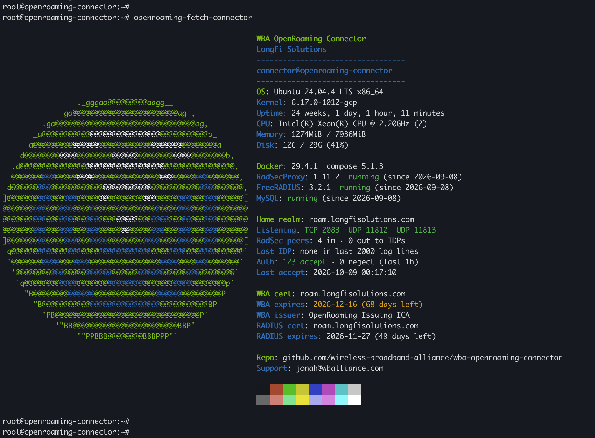
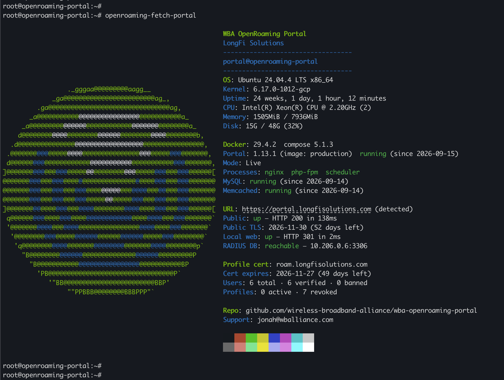

# openroaming-fetch

neofetch-style login banners for [WBA OpenRoaming](https://wballiance.com/openroaming/) servers: one for the [OpenRoaming Connector](https://github.com/wireless-broadband-alliance/wba-openroaming-connector) (hybrid deployment) and one for the [OpenRoaming Provisioning Portal](https://github.com/wireless-broadband-alliance/wba-openroaming-portal).

Alongside the usual OS and hardware lines, each one reports what you actually need to know about that server at a glance: whether the containers are up, whether RadSec is connected, how authentication is going, whether the portal is reachable from outside, and when each certificate expires.





---

## What it shows

Both banners put your organisation's name under the WBA OpenRoaming title. The connector reads it from your WBA certificate and the portal from its Display Name setting, or you can set it yourself.

**Connector** (`openroaming-fetch-connector`)

| Row | Where it comes from |
|---|---|
| RadSecProxy, FreeRADIUS, MySQL | Container state and versions, found by their Compose labels |
| Home realm | The realm `prepare-debian11.sh` wrote into `radsecproxy.conf` |
| Listening | TCP 2083 and UDP 11812/11813 on the host |
| RadSec peers | Established RadSec sessions inbound, and outbound to IDPs, counted inside the radsecproxy container |
| Last IDP | The last roaming realm resolved through NAPTR discovery |
| Auth / Last accept | Access-Accept and Access-Reject counts from the FreeRADIUS log over the last hour |
| WBA cert | Your OpenRoaming client certificate: name, issuer, expiry (amber inside 90 days) |
| RADIUS cert | The certificate the **running** FreeRADIUS container serves (amber inside 21 days) |

The RADIUS certificate is copied into the FreeRADIUS image at build time, so renewing Let's Encrypt on the host changes nothing until the image is rebuilt. When the host copy and the running copy differ, the banner says `host copy differs — rebuild freeradius`.

**Portal** (`openroaming-fetch-portal`)

| Row | Where it comes from |
|---|---|
| Portal | Release from the portal's `composer.json`, plus the image tag if it differs |
| Mode | The portal's platform mode — Live, or Demo in amber |
| Processes | nginx, php-fpm and the Symfony scheduler inside the web container, each checked separately |
| MySQL, Memcached | Container state |
| URL / Public / Public TLS | The public portal address — detected from the portal's own redirect — checked from outside, with its certificate expiry |
| Local web | The web container on port 80 |
| RADIUS DB | Whether the web container can reach the connector's FreeRADIUS database (host and port only — credentials are never shown) |
| Profile cert | The RADIUS server certificate embedded in every profile the portal hands out (amber inside 21 days) |
| Users / Profiles | Counts straight from the portal database |

---

## Requirements

Nothing to install. Only tools already on a stock Ubuntu or Debian host:

`bash` · `docker` · `openssl` · `curl` · `ss` · `nsenter` · `timeout`

**neofetch is not required** — this only borrows the layout. A 24-bit colour terminal shows the logo in the real OpenRoaming colours; anything else gets the closest match.

---

## Install

On the server, as root:

```bash
git clone https://github.com/preston-longfi/openroaming-fetch.git
cd openroaming-fetch
sudo ./install.sh connector      # on a connector server
sudo ./install.sh portal         # on a portal server
```

The installer copies the banner to `/usr/local/bin`, finds the deployment from its running containers, and runs the banner once so you can see it. It asks three questions:

- your organisation name, suggesting the one it detected
- a support contact
- whether to show the banner every time someone logs in (see [Login banner](#login-banner))

It only asks anything else when it can't detect the answer. It also checks that you picked the right banner for the server, and stops if you didn't. To skip the questions and take what it detects, add `--yes`.

To upgrade later, pull and run the installer again — it keeps your settings:

```bash
git pull && sudo ./install.sh connector
```

To remove it:

```bash
sudo ./install.sh connector --uninstall
```

### Login banner

The banner can run on every SSH and console login, through Ubuntu and Debian's `update-motd`. The installer offers this; to turn it on later, run the installer again with `--motd`:

```bash
sudo ./install.sh connector --motd
```

Or by hand, without the installer:

```bash
sudo tee /etc/update-motd.d/99-openroaming-fetch-connector >/dev/null <<'EOF'
#!/bin/sh
/usr/local/bin/openroaming-fetch-connector
EOF
sudo chmod +x /etc/update-motd.d/99-openroaming-fetch-connector
```

(On a portal server, use `portal` in place of `connector` throughout.)

Test it without logging out:

```bash
sudo run-parts /etc/update-motd.d/
```

The `99-` prefix puts it after Ubuntu's own login messages. To have it on its own, switch off the noisiest of those:

```bash
sudo chmod -x /etc/update-motd.d/10-help-text /etc/update-motd.d/50-motd-news
```

To turn the login banner off again but keep the command, delete the file:

```bash
sudo rm /etc/update-motd.d/99-openroaming-fetch-connector
```

Worth knowing:

- The banner makes a few Docker calls, which adds a second or two to each login.
- If nothing shows at login, check for a `~/.hushlogin` file, which hides all login messages for that user.
- Upgrading with the installer keeps the login banner on if it was on.

### Why root

Docker queries, reading certificates, and counting sessions inside the radsecproxy container all need root. Without it every lookup degrades to `n/a` rather than failing. Login banners run as root via `pam_motd`, so they get the full picture with no extra setup.

---

## Settings

Everything is detected at run time, so most installs need no settings at all. To override something, edit:

- `/etc/default/openroaming-fetch-connector`
- `/etc/default/openroaming-fetch-portal`

Each file lists every setting, commented out. Uncomment a line to override it. The most useful ones:

| Setting | Banner | Default |
|---|---|---|
| `CONNECTOR_DIR`, `HYBRID_DIR`, `COMPOSE_PROJECT` | connector | Read off the running radsecproxy container |
| `AUTH_WINDOW` | connector | `1h` |
| `PORTAL_DIR`, `COMPOSE_PROJECT` | portal | Read off the running web container |
| `PORTAL_URL` | portal | Detected from the portal's redirect, `DEFAULT_URI` or `SAML_SP_ACS_URL` — or asked for at install |
| `ORG` | both | Detected — WBA certificate on the connector, Display Name on the portal |
| `TITLE`, `SUPPORT` | both | The header line and support contact |

---

## Troubleshooting

| Symptom | Cause |
|---|---|
| Everything after `Disk` shows `n/a` | Not running as root |
| Containers show `not found` | Not a Compose deployment, or a different Compose project — set `COMPOSE_PROJECT` |
| `Listening` ports red on a working connector | Docker's userland proxy is off, so published ports don't appear as host sockets. Cosmetic |
| `Last IDP: none in last 2000 log lines` | Only home-realm users authenticated recently — normal on a quiet connector |
| `URL: not set` | Nothing the portal is configured with names a public address. Common, because the portal can be served behind a load balancer, with its own SSL compose file, or over plain HTTP. Set `PORTAL_URL` |
| `Public: unreachable` but the portal works | This server can't reach its own public address (common behind cloud load balancers) |
| `RADIUS DB: unreachable` | The web container can't reach the connector's MySQL — check firewall rules for port 3306 between the two |
| Logo looks like an oval | Terminal fonts differ in how tall each character cell is. Zoom one step out, or change line spacing |

The palette bar at the bottom doubles as a terminal test: if those sixteen blocks render monochrome or wrong, the problem is your terminal rather than anything here.

---

## Licence

Apache License 2.0, the same as the WBA OpenRoaming Connector and Portal. See [LICENSE](LICENSE).
